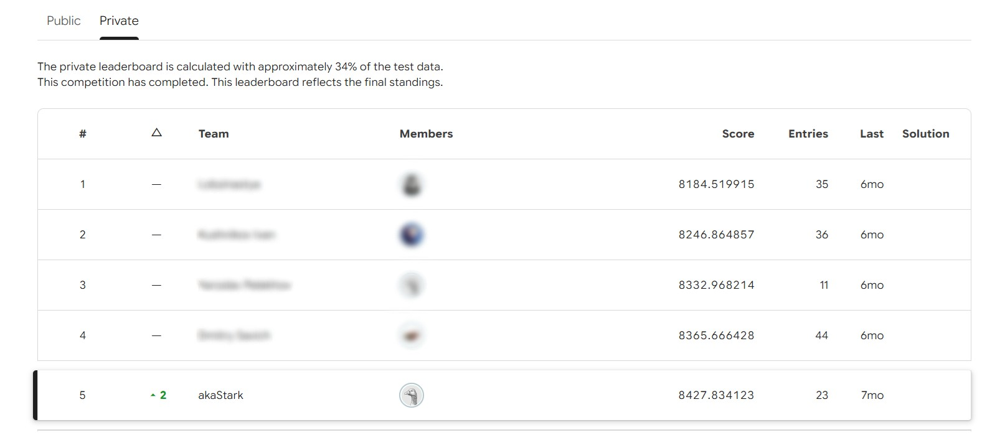

# NYC Availability Forecast

Прогнозирование количества дней, в течение которых объявление о краткосрочной аренде в Нью-Йорке доступно для бронирования, с помощью feature engineering и ансамбля градиентного бустинга.

## О проекте

Проект выполнен в формате Jupyter Notebook в рамках ML-соревнования. Основная задача — предсказать целевую переменную `target` в диапазоне от **0 до 365 дней**. Работа включает исследовательский анализ данных (EDA), построение признаков, подбор гиперпараметров и обучение двухуровневого ансамбля.

Основной ноутбук: `nyc-availability-forecast.ipynb`. 
Это соревнование, автор занял пятое место.


## Подход

### 1. Исследовательский анализ данных

В ноутбуке исследуются распределения признаков и целевой переменной, динамика данных по времени, характеристики объявлений, отзывы, типы жилья и повторяющиеся идентификаторы. Отдельное внимание уделено изменениям распределения данных начиная с 2018–2019 годов и мультимодальности целевой переменной: заметны пики около 0 и 365 дней.

### 2. Feature engineering

Признаки организованы в несколько блоков:

- **ID-признаки** — сглаженный target encoding и статистики по повторяющемуся `_id`, включая количество записей, характеристики истории объекта и взаимодействия с временными и ценовыми признаками.
- **Географические признаки** — расстояния до ключевых районов Нью-Йорка, кластеры координат, плотность объявлений и характеристики ближайших соседей.
- **Базовые признаки** — преобразования минимального срока бронирования, временные признаки по дате последнего отзыва, характеристики активности и производные ценовые признаки.
- **Агрегатные признаки** — статистики по хостам, районам, типам жилья и координатной сетке.
- **Текстовые признаки** — признаки из названия объявления, TF-IDF с TruncatedSVD и семантические эмбеддинги SentenceTransformer с последующим снижением размерности и кластеризацией.

Для признаков, требующих обучения преобразований, используется разделение `fit` / `transform`, чтобы обучать преобразования на train и применять их к test.

### 3. Кодирование и отбор признаков

Категориальные признаки кодируются с помощью `CatBoostEncoder` с использованием OOF-подхода. Для мягкого отбора признаков обучается CatBoost и анализируется важность с помощью SHAP. Отбор ограничен наиболее бесполезными признаками, чтобы не потерять качество модели.

### 4. Обучение моделей

Финальная архитектура — **двухуровневый stacking**:

- **Первый уровень:** CatBoost, LightGBM и XGBoost в задачах регрессии.
- **Второй уровень:** Ridge-регрессия (`alpha=1.0`), обученная на OOF-предсказаниях базовых моделей.

Гиперпараметры бустингов подбирались с помощью Optuna и TPE-сэмплера. В ноутбуке используются сохранённые параметры; повторный запуск поиска гиперпараметров занимает значительное время.

### 5. Валидация

- `StratifiedKFold`: 5 фолдов, `shuffle=True`, `random_state=42`.
- Стратификация выполняется по бинам целевой переменной.
- Основная метрика — **MSE (Mean Squared Error)**.
- OOF-предсказания используются для оценки базовых моделей и мета-модели.
- Итоговые предсказания ограничиваются диапазоном `[0, 365]`.

## Результаты и наблюдения

По итоговой оценке в ноутбуке RMSE составляет примерно **93 дня** (при MSE порядка 8 700). Stacking даёт лишь небольшое улучшение относительно сильнейшей отдельной модели. Анализ неопределённости указывает, что качество ограничено в значительной степени шумом и неоднородностью данных.

Основные направления дальнейшей работы:

- добавить внешние данные о районах Нью-Йорка и транспортной доступности;
- обогатить описание объявлений дополнительными полями;
- исследовать специализированную модель для разных режимов целевой переменной около 0 и 365 дней;
- проверить устойчивость модели к использованию идентификаторов хостов и временным сдвигам в данных.

## Технологии

- Python
- Jupyter Notebook
- pandas, NumPy
- Matplotlib, Seaborn, Folium
- scikit-learn
- CatBoost
- LightGBM
- XGBoost
- Optuna
- SHAP
- SentenceTransformers
- PyTorch
- UMAP

## Структура проекта

```text
.
├── README.md
├── nyc-availability-forecast.ipynb
└── nyc-availability-forecast.html
```

Соревнование является приватным, поэтому автор не может предоставить ссылку.

## Важные замечания

- Данные соревнования не распространяются вместе с проектом.
- В ноутбуке есть вычислительно затратные этапы, включая создание эмбеддингов, географических признаков и обучение ансамбля.
- Target encoding и признаки на основе истории `_id` требуют аккуратной OOF-валидации: при неправильном разбиении возможна утечка целевой переменной между train и validation.
- Подбор гиперпараметров Optuna в текущем ноутбуке не запускается автоматически: используются заранее подобранные параметры. При необходимости можно включить соответствующие ячейки.
- Результаты зависят от версии библиотек, доступных данных и конфигурации окружения.

